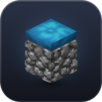

# Cobble Comfort

A client-side quality-of-life mod for **Minecraft 26.3 (Fabric)**: a map and minimap, a storage memory for your
chests, a customisable HUD, smarter inventories, chat comfort and lots of small touches. Everything can be switched on
or off and tuned in the settings. The mod is available in English and German.

It works on any server, including vanilla ones. An optional server plugin lets players with the mod see each other on
the map.

## Download and installation

1. Install [Fabric Loader](https://fabricmc.net/use/) (0.20.1 or newer) for Minecraft 26.3.
2. Put these into your `mods` folder:
   - `cobble-comfort-<version>.jar` from the [latest release](https://github.com/fkleindev/Cobble-Comfort/releases/latest)
   - [Fabric API](https://modrinth.com/mod/fabric-api)
   - [YetAnotherConfigLib (YACL)](https://modrinth.com/mod/yacl)
   - optional: [Mod Menu](https://modrinth.com/mod/modmenu), to open the settings from the mod list
3. Start the game. Java 25 or newer is required (the official launcher brings it along).

**Updates:** when a new release is out, a button on the title screen says so. From there you can read what is new, or
download it: the new jar replaces the old one as soon as you quit the game, and is active from the next start (checked
against the release's SHA-256). Nothing is downloaded unless you click; the check itself can be turned off under
General.

**Settings:** through Mod Menu, the map's side bar, or bind a key to *Open settings* under Options → Controls → Key Binds →
Cobble Comfort. The settings have a category list with icons, a search over all options, and every change applies at
once.
There is also a key for the HUD editor.

## Features

### Map and minimap
- Minimap (round or square, optionally rotating) with coordinates, biome, players, mobs with their faces, a view cone
  and your movement trail.
- Full-screen map (**M**) with height shading and a chunk grid. It opens out of the minimap, turning north-up as it
  grows, and shrinks back into it when you close it.
- **Cave layers:** every 16 blocks of height is its own saved layer, in the Overworld and below the Nether roof. Like
  Xaero's map, a layer is mapped while you are in it. Underground, the map and minimap switch to the layer you are in;
  on the Nether roof they show the roof. A slider on the map picks any layer by hand (also Page Up/Down), "A" follows you again.
- The map is the mod's hub: a bar at its top left opens the storage search, traders, pets, waypoints, resource tracker,
  HUD editor and settings.
- Waypoints (**B** for a new one, **U** for the list) with categories, colours, beams in the world, name and distance.
  Right-click the map for a menu, double-click to set one. New waypoints drop onto the map with a small bounce.
  Waypoints outside the minimap show as small arrows on its edge, which pulse when a waypoint leaves the view.
- Automatic waypoints for your death points and for your current respawn point (bed or respawn anchor).
- **Death inventory:** hover a death waypoint on the map to see what you dropped, with valuable items first. Items you
  pick up again are ticked off ("7/11 stacks back"). A timer shows when the rest despawns. It only runs while you are
  near, because items only despawn while their chunk is loaded, and it also gives the earliest time in case the chunk
  stayed loaded. A popup warns shortly before the despawn. The waypoint turns green when everything is back and grey
  when the items are lost.
- Waypoints appear in the vanilla locator bar above the hotbar, and other players there show as their heads. Look
  straight at one to see its name and distance.
- Waypoints shared in chat in the Xaero format become clickable, and Xaero waypoints can be imported.
- With the world seed: unexplored terrain and structure markers (villages, temples, strongholds, ...). Structures you
  find while exploring are marked too.
- Nether and overworld coordinates are converted for you.

### Storage memory
- Remembers what is in every chest, barrel, shulker box, furnace, hopper, minecart and so on that you open, plus your
  ender chest.
- Search everything you have stored (**N**). The containers holding an item are outlined in the world, shown on the
  map, and a compass arrow points the way.
- Name your containers. See their contents in the look info and get a hint in your inventory when more of an item is
  stored elsewhere.

### Trade memory
- Remembers the offers of every villager and wandering trader you trade with: price (with your discounts), stock,
  job and level.
- Search them in the storage memory's **Traders** tab ("Where was the librarian with Mending?"), cheapest first.
  Click a trader to see it on the map.
- Traders show up on the map with their job block. Hover one to see its offers.
- Item tooltips name who sells the item or buys it for emeralds, with price and distance.
- Name your traders in the trading screen. Traders are followed while they walk around nearby, and forgotten when
  they die or change jobs.

### Pet memory
- Remembers your wolves, cats, parrots and nautiluses (the ones you tamed), and the horses, donkeys, mules, llamas,
  camels and happy ghasts you have ridden or opened, each with its name and where you last saw it.
- They show on the map. Hover one to see its health, whether it sits or is leashed, and a horse's speed and jump
  height.
- Search them in the storage memory's **Pets** tab and click one to see it on the map.
- When a pet dies, a popup tells you, and a grey grave with the death message stays on the map until you remove it.
  Living pets breathe softly on the map, and a fresh grave rises from a little puff of dust.

### Furnace memory
- Furnaces, blast furnaces, smokers and brewing stands you look into are remembered with an estimate of when they will
  be done.
- A label above the block, markers on the map and minimap, and a popup with a sound when something is finished.
- Time only counts while you are near enough for the furnace to actually run.

### HUD
- **HUD editor:** move, scale and hide every HUD element, with snapping, a grid and presets.
- **Look info:** what you are looking at, with the right tool, crop growth, redstone power, breaking progress, health,
  armour, villager level, horse speed and jump height, and container contents.
- **Info HUD:** pick your lines from coordinates (also in the other dimension), direction, biome, light level, time and
  day (with a hint when you can sleep), weather, FPS, ping, chunk, speed, real time and the targeted block. **F6**
  copies your coordinates.
- **Phantom warning:** an info HUD line shows how long ago you last slept, from the second day on, with a
  countdown to when phantoms can spawn. During the last day a small countdown appears on the HUD, and a popup tells you
  once phantoms can come. Then little phantoms glide through the panel.
- **Armour HUD** with durability, a low-durability warning and an arrow counter.
- **Effect HUD** with remaining time, good and bad effects kept apart, and a warning before an effect runs out.
- **Food HUD:** saturation, exhaustion, a preview of what eating restores, and the best food in your inventory.
- **Resource tracker (K):** set collection goals and watch your progress, counting shulker boxes, bundles and nearby
  chests.
- **Pickup log:** a small list like "+32 Cobblestone" that merges amounts and shows your total.
- **Smooth hotbar:** gliding selection, a slightly enlarged selected item and slot numbers. A tool that breaks
  shatters into shards in its slot.
- **HUD animations:** lost health stays bright for a moment and then runs down, healed hearts pop, the experience bar
  fills smoothly with a counting, pulsing level and a "+7" for picked-up experience, shanks and armour pop and fade,
  bubbles pop back, and boss bars glide and run down like the hearts. A level up sends a beam of light up from the
  level number, and at level 30 an enchanting table glows above it.

### Inventory
- **Inventory tools:** search field (also searches tooltips and shulker contents), sort buttons or middle click to sort,
  and slot locks that protect items from being moved or dropped.
- **Inventory sections:** a button in the inventory switches to a view that splits your inventory (not the hotbar) into
  sections by kind of item: blocks, functional blocks, tools, combat, food, materials, other and free slots. When an
  item of another kind lands in a slot, the slot slides over to its section. Only the view changes, so it works on any
  server.
- **Bundle panels:** next to the inventory and containers, a panel for every bundle shows what it holds, rounded and
  tinted in the bundle's colour. Click an item to take it out, shift-click to put it straight into the inventory, click
  with an item on the cursor to put it in. A button above the inventory shows and hides them. Uses only vanilla clicks,
  so it works on any server.
- **Moving items:** in chests, barrels, shulker boxes and other storage, one button deposits everything the container
  already holds some of, another tops up your stacks from it; the items fly over one after another. Hold Shift and drag
  over slots to move them all at once.
- **Shulker preview:** see the contents in the tooltip, as a panel while holding the box, and a fill bar.
- **Map and book preview:** maps show their picture in the tooltip, with markers, your own position, scale, centre
  and distance. Written books and books and quills show a page (scroll to turn pages), and enchanted books a compact
  list of enchantments with their level. Hold Shift for a larger view.
- **Rarity:** coloured frames for uncommon, rare and epic items, with optional pulse and shimmer.
- **Inventory effects:** the carried item tilts and pops, slots squash and flash, items fly, with particles and sounds.
- **Workstations and trading:** furnace flames and arrows move smoothly instead of in pixel steps and a finished item
  glints. Results in the anvil, grindstone and smithing table land with a clonk and sparks, and the anvil's XP cost
  counts up. Offers a villager unlocks slide into the list, and its level bar fills smoothly.
- **Smooth GUIs:** inventories, menus and chat open with a short animation. Tooltips fade in, follow the mouse softly and glide from
  one item to the next. Lists, the chat, the creative inventory and the mod's own screens scroll smoothly, and recipe book
  pages slide in.
  Buttons fade their highlight, sliders glide, checkboxes and switches animate, and creative and recipe book tabs slide
  out when picked.
- **Durability and cooldowns:** durability bars glide down and blink shortly before the item breaks; cooldowns (ender
  pearl, shield, wind charge, ...) close a ring around the slot instead of covering the item, with a flash when ready.

### Enchanting
- **Enchantment descriptions:** what each enchantment does, its maximum level, what it applies to and what it conflicts
  with (hold Shift).
- **Enchanting table:** bookshelf counter and markers that show which shelves count or are blocked, the chances for each
  slot, and readable runes.

### Chat
- Player heads in front of messages.
- Timestamps, and repeated messages stacked as "×3".
- Your name and your own keywords highlighted, with a sound.
- Chat search (**Ctrl+F**) and right-click to copy a message.
- Chat tabs: All, Chat, Private, Trade, System and your own tabs by keyword, with unread counts. The closed chat still
  shows everything. In the Private tab, what you type goes to your last partner, and incoming private messages ping
  and blink violet. The marker glides to the chosen tab, and counts hop when something new comes in.
- Longer history that is kept when you disconnect.

### Toasts and player list
- Toasts slide in and out smoothly, and the others move up when one has gone. Advancements made in a row stack onto one
  toast with a "+2", recipe toasts show how many recipes they hold, toasts stay a shorter time, and recipe toasts can be
  switched off.
- The player list fades in, shows the ping as a coloured number, lets players glide to their new place and fade in when
  they join, and frames heads in their team colour.
- Players who have the mod get the Cobble Comfort icon in front of their name in chat, the player list and their name
  tag (others are recognised on servers with the Cobble Comfort Sync plugin).

### Crosshair and transitions
- **Hit marker:** short strokes around the crosshair when an attack lands, yellow for critical hits and red and larger
  for kills.
- **Cooldown ring:** with the attack indicator set to Crosshair, a thin ring around the crosshair closes while the attack
  charges.
- **Transitions:** the world fades in from black after loading and changing dimension, the death screen fades in over a
  greyed world, waking up fades back in, and titles and action bar messages slide in (new action bar messages cross-fade).

### Other
- **Zoom (C):** hold or toggle, scroll to change the zoom level, smooth transition, optional cinematic bars.
- **Fullbright (G):** see in the dark, with a smooth fade.
- **Totem plush:** totems of undying look like a soft 3D chibi plush of the player holding them, with their skin,
  whatever your resource pack shows: in your hands and other players' hands, in the inventory, when a totem saves you,
  and in item frames, on the ground and in mobs' hands (there as a plush of you). Its head, arms and legs jiggle softly
  as you walk and look around, and it squishes when you take it, when it saves you and when its holder is hit
  (harder the more damage). Works with Punchy's first-person arms.
- **Name charm:** renamed weapons and tools get a little tag with their name, hanging from the handle on a string. The
  tag is cut from the tool's material (planks, cobblestone, copper, iron, gold, diamond or netherite, always in the
  game's own block textures, whatever resource pack is on). It swings with real pendulum physics as you swing, look
  around, walk and jump, also on other players, mobs, in item frames and on the ground. It hangs on top of whatever
  model your resource pack gives the item and follows Punchy's first-person arms.
- **Plush pets:** a wolf or cat plush on your back, picked in the wardrobe's back tab in any of the game's wolf
  and cat variants once you have tamed one. As a **charm** it hangs on a string, back to you, looking out with its
  legs dangling, and swings with pendulum physics as you walk, jump and turn. As a **backpack** it is worn bigger with
  straps over your shoulders, its face peeking out behind you. Head, legs and tail jiggle and the plush is squeezed
  when you are hit (the game's own baby model and textures, whatever resource pack is on).
- **Wardrobe (J):** one screen to dress your character, with the figure on a turntable: up to three badges pinned to
  your chest as little voxel pins, the symbol a vanilla item where there is one (ten to wear right away, twelve more
  earned with advancements such as Diamonds!, Free the End or Hero of the Village), a hat worn instead of your
  helmet, which pet hangs as plush charm or backpack, the belt and name charms, and named outfits to switch between.
  Also opened with the hanger on your figure in the inventory or from the map. Other players with the mod see your
  badges and hat through the server plugin. What you earn counts in the world or on the server you earned it in.
- **Hats:** voxel models that take the place of your helmet or turtle shell: crowns, flower wreaths, an aviator cap
  with goggles, a miner's helmet with a lamp, a pirate tricorne, a halo, a straw hat, a fisherman's hat, a chef's hat,
  a beanie (one of them a bee beanie with a little bee buzzing round it), a baseball cap (one with a creeper face), a
  nightcap, a propeller beanie, bunny ears, a mortarboard, a top hat, a cowboy hat, headphones (notes rise from them
  while a jukebox plays nearby), a party hat that sheds confetti, a sombrero with dancing pompoms, a beret, a
  Tyrolean hat, a captain's cap, an ushanka, a tiara and a ninja headband. In October and November there are also
  autumn and Halloween hats (a leaf wreath, an acorn cap, a mushroom cap, a witch hat with a dangling spider, a
  jack o' lantern, devil horns, a bat on a spring), and in December and January Christmas and New Year hats (a Santa
  hat with a flopping pompom, reindeer antlers, an elf hat with a jingle bell, a glittering New Year's top hat that
  sheds confetti). Seasonal cosmetics (hats, neck and back pieces, charms) can only be earned in their months, the
  free ones just by playing then, and once earned they can be worn all year. A band, ring, stripe, brim or visor
  edge shows which helmet is under it (leather in its dye, chainmail links, iron, gold, diamond, netherite, copper,
  turtle scutes) and glints when the helmet is enchanted; an armour trim colours a gem, flower, buckle, lens, lamp,
  patch or logo. Strands, ribbons, ear flaps, ears, feathers, pompoms, tassels, cables and tips swing as you move, and
  a propeller spins. Each kind comes in several colours, earned with an advancement, by finding an item or by
  entering a biome; the wardrobe shows one tile per kind and opens its colours on a click.
- **Neck:** a wardrobe tab for what you wear round your neck, over a chestplate too: scarves with fringed ends,
  necklaces with a pendant (heart, emerald, ender pearl, totem, compass), bow ties, ties, bandanas, leis, bell collars
  (the bell rings softly as you walk) and feather boas, each in several colours. Ends, pendants and tips swing as you
  move. Bow ties and ties are free, the others are earned by finding an item or entering a biome. In October and
  November there are also a scarf knitted with autumn leaves, a chain of little pumpkins with a glowing jack o'
  lantern, a tall vampire collar and a bone necklace with a skull; in December and January fairy lights that glow
  and twinkle, a glittering tinsel boa and a Nordic scarf.
- **Back:** a wardrobe tab with two parts. **Back:** what you carry: a wolf or cat plush backpack, a hiking pack
  with a bedroll and a dangling mug, wings (angel, fairy or bat) that beat as you move, a sword (the game's own
  icon) across your back, a guitar or a turtle shell pack. **Back charms:** what hangs on a string
  from it (from one of the wings, or from your shoulder without anything): a wolf or cat plush, mini plushes
  (creeper, axolotl, bee, slime), a glowing lantern, lucky charms (clover, horseshoe, star) or a little bell that
  rings as you walk. Any charm goes with anything on the back. In October and November there are also night wings
  (leathery bat wings with finger bones), a witch's broom, a glowing carved pumpkin pack and a scythe, and as
  charms a softly glowing ghost, a little jack o' lantern, an acorn and a wrapped sweet. In December and January:
  Santa's gift sack, ice wings that shed snowflakes, a little decorated Christmas tree with a shining star, and a pack
  of New Year's rockets that spray sparks while you jump or fall; as charms a bauble, a gingerbread man, a candy cane
  and a little snowman.
  Cosmetics that borrow the game's textures (pins, plushes, the belt's weapons, the sword, name charms) always use
  the vanilla ones, whatever resource pack is on, so they look the same for everyone.
  Hats, face, neck and back pieces are textured like the companions in what they are made of: felt and cloth, knitted
  wool, plaited straw, leather, wood grain, leaves, fur, feathers and metal.
- **Totem:** a wardrobe tab for how your totems of undying look: the plush of you, a Mini-Me plush wearing your hat
  and neck piece, or the game's own totem (all three from the start), or a plush allay, axolotl (in its five colours),
  creeper, frog (three colours), bee, warden with a beating heart or a little Ender Dragon, earned with an advancement,
  by finding an item or entering a biome. In December and January a snowman and a gingerbread man. Wings flap.
- **Face:** a wardrobe tab with three places worn together, hidden under a helmet. **Eyes:** round glasses,
  sunglasses, an eye patch, a masquerade mask whose feather springs as you turn your head, and steampunk goggles with a
  loupe that flip up onto your forehead when you look up. **Nose & mouth:** a bandana mask with its knot ends swinging
  behind your head, a twirled or walrus moustache, and a pipe (wooden, corncob or dark briar) with a glowing ember that
  puffs smoke now and then (bubbles under water). **Paint:** blush, freckles or war paint on the skin, under whatever
  else you wear. In October and November a pumpkin or skull mask, in December and January a glowing reindeer nose, in
  February a clown nose.
- **Weapons & tools:** a wardrobe tab to choose a charm for each kind of weapon and tool (sword, axe, pickaxe, shovel,
  hoe, spear, mace, trident, bow, crossbow, fishing rod): the name tag (renamed items only), a tassel, a gem chunk,
  feathers, a fish lure, a little bell or a glow berry, most in several colours. They swing like the name charm. A 3D
  editor lets you tie each kind's charm wherever you like on the item: click to place it, drag to turn the item,
  separately for first person.
- **Companion:** a wardrobe tab for a little voxel companion that follows you everywhere: a mushroomling, a cloud
  sheep, a mini dragon, an owl, a mini golem, a red panda, a sea turtle, a kitten in a box, a shadow wolf, a hedgehog,
  a penguin chick, a mini mech, a lava salamander, a lantern spirit, a shadow wisp, a little whirlwind, a ball of yarn
  and a baby panda, each in several variants, plus a pumpkin imp in October and November, a little snowman in December
  and January and an Easter bunny in April. Each is textured in its own material (fur, wool, scales, feathers, stone,
  shell, cardboard, quills, down, brushed metal, copper, basalt...). It walks, hops, floats or flies, follows you up
  stairs, swims, rides along, settles down near you when you stop (only getting up once you walk off), strolls about
  now and then, sits and falls asleep after a while. Each has its own things to do: the red panda rears up, nibbles
  bamboo and washes its face; the turtle hides in its shell, munches a berry and yawns; the kitten ducks into its box,
  peeks out and hops out to stretch; the shadow wolf howls, bows down to play, steps through the shadows to your other
  side and fades into the dark at night; the hedgehog sniffs about, curls up shyly and rolls after you as a ball; the
  penguin chick waddles, flaps, shakes itself fluffy and slides on its belly over snow and ice; the mini mech stomps
  with puffs of steam, scans with a beam of light, hovers on rocket boots, lights a headlamp at night and its copper
  slowly turns green (petting polishes it); the lava salamander glows in the cracks of its basalt scales, flicks its
  tongue, does push-ups, basks, yawns embers and steams in the rain; the lantern spirit floats along with a face in
  its flame, burns brighter at night, circles you at shoulder height in dark caves with a soft glow on the ground,
  gutters at monsters nearby, flickers wildly at a hissing creeper, dims and stays close when you are badly hurt and
  all but goes out near a warden (the copper one slowly turns green); the shadow wisp glides through air and walls
  alike, faint in the light and nearly solid in the dark, peeks out of a wall next to you now and then, loops the
  loop, ducks into its tail to pop out with a boo (right in front of other players who come close) and flickers in the
  Nether; the little whirlwind spins along whirling leaves (sand, snowflakes) and whatever it passes over, and runs
  tall and wild with gusts when you sprint; the ball of yarn rolls after you laying its thread out behind it,
  shrinking as it unwinds, and winds itself up again when you stop (cats nearby can't take their eyes off it, and
  kittens go and bat at it); the baby panda waddles, sits up to munch a stalk of bamboo (and trots over to any bamboo
  nearby to do so), turns somersaults, flops onto its back paddling its paws and sneezes.
  The mini dragon and the owl keep a little more distance in the air and race along beside you when you glide on
  elytra, wings swept back, trailing streams of air.
  It warms itself by a lit campfire near you, gazing into the flames and dozing off sooner; begs in front of you while
  you eat, sitting up or hopping, and sometimes catches a crumb; gallops after you in bounds when you sprint; and now
  and then trots over to sniff at an item on the ground or a flower, sometimes sneezing. It keeps a little more
  distance and does not walk off ledges it could not climb back up.
  Sneak up and look at it to pet it. Give it a name, a bow, collar, flower or crown. When two players with companions
  stand together, the companions walk up to each other, sniff, hop with hearts and sometimes play tag. It is only
  drawn: never in the way, and blocks can still be placed where it stands. Other players with the mod see it through
  the server plugin.
- **Belt:** a belt at your hips carries what you have with you, all of it swinging as you walk, jump and turn.
  Bundles hang in front and behind as little leather pouches in their colour, puffing up as they fill (up to four:
  hotbar first, then the fullest from the inventory). A sword from the hotbar hangs on the left hip (or a spear, mace
  or axe), a bow or crossbow on the right with a quiver behind it, more arrows sticking out the more you carry. What
  is in your hand stays in your hand. Other players with the mod see it through the server plugin.
- **Swaying plants:** grass, ferns, flowers, saplings and crops bend softly away when players or mobs walk through
  them and swing back; potted plants wobble when someone brushes past. Lily pads dip under whoever stands on them and
  rock in the wake of boats; leaves shake and drop a few falling leaves when someone runs or jumps into them or a
  projectile flies through. Works with Sodium and Iris shaders; only the few plants around someone are animated, so it
  costs next to nothing elsewhere.
- **Swinging hangings:** free-hanging vines, weeping vines, glow berries, hanging roots, pale moss, spore blossoms,
  lanterns on chains and bells swing when players, mobs, boats or projectiles push them. Long vines and chains bend
  like a rope, and a light, adjustable breeze keeps the ones near you swaying.
- **Wobbly arrows:** arrows and bee stingers stuck in a player wobble as they walk, jump and land, and twang when they
  are hit; on you and on other players, no plugin needed.
- **Soft doors:** doors, trapdoors and fence gates (wood, iron and copper) swing open and shut with a little overshoot
  instead of snapping; gates swing as two halves around their posts. Only the look is animated, so you can still walk
  through at once. Speed and bounce are adjustable; works with Sodium and Iris shaders.
- **Footprints:** players and mobs walking over snow, sand or mud leave prints that slowly fade away again: shoes,
  paws, hooves and bird claws, depending on who walked there. Sneaking leaves fainter ones, and rain or snowfall
  wears them away sooner. Coming out of the water, wet feet leave dark prints on any ground for a few steps.
- **Atmosphere:** small clouds of breath in the cold (snowy biomes, high mountains), from players, animals and
  villagers but not the undead; rings and splashes where someone wades through shallow water; water dripping off
  players and companions who come out of the water or stood in the rain (drying faster in the heat and steaming by a
  fire, a jump shakes off a shower of drops, companions shake themselves), and from leaves and roof edges after the
  rain, with rings where the drops fall into water; a cloud of dust where players and mobs land after a fall, bigger
  the longer the fall; fireflies blinking over swamps, meadows, flower forests and cherry groves on clear nights,
  darting away from players; by day butterflies fluttering from flower to flower wherever flowers grow under the open
  sky (gardens and greenhouses too, big tropical ones in the jungle), settling on them and getting out of the way of
  players and companions (who watch them and sometimes chase them), and dragonflies over water hanging in the air,
  darting off in a zigzag and resting on lily pads and reeds; and snow settling on players' heads and shoulders in
  snowfall, which they shake off by jumping and which melts under a roof. Birds fly over now and then, suited to the
  biome: gulls over the sea, geese in a V, ducks and herons over swamps, songbirds over forests, parrots in the
  jungle, ravens over the taiga, eagles and vultures circling over mountains and dry land; at night owls and bats.
  Little voxel models that work with shaders, with quiet calls; how often is adjustable.
- **Light overlay (F7):** red crosses on blocks where monsters can spawn at any time, yellow ones where they can only
  spawn at night, following the real spawn rules (no crosses on glass, slabs, carpets or in mushroom fields) and the
  light limits of each dimension. Optionally the block light as a number. Crosses fade out as you light up an area. The
  light level in the info HUD uses the same colours.

All keys can be changed under Controls.

## Server plugin: see each other on the map

**Cobble Comfort Sync** is an optional plugin for Spigot or Paper servers (1.21 or newer). It shares player
positions between clients running the mod, so friends show up on the minimap and map beyond render distance and in
other dimensions.

- **Opt-in:** a player is only shared after switching on *Share position with other players* in the mod (in the map's
  layer sidebar or the settings), and only those who share see the others.
- Players without the mod are never sent anything and never show up.
- Shared are the name, world, position, facing and, unless switched off, health and armour.
- It also shares the **pet plushes** each player with the mod wears on their back (charm and backpack: pet type,
  variant and collar colour), **what hangs on their belt** (bundle colours and fullness, weapons and arrow count) and
  **what they chose in the wardrobe** (badges, hat, face, neck and back pieces, their companion, the charms on their
  weapons and tools, and how their totems look), so everyone with the mod sees them. The plugin only passes these on,
  so new cosmetics need no plugin update.

### For server admins

Put `cobble-comfort-sync-<version>.jar` from the [latest release](https://github.com/fkleindev/Cobble-Comfort/releases/latest)
into the server's `plugins` folder and restart. Settings are in `plugins/CobbleComfortSync/config.yml`:

| Key | Default | Meaning |
| --- | --- | --- |
| `interval-ticks` | `10` | How often positions are sent (20 = once a second). |
| `max-distance` | `0` | Only share players within this many blocks in the same world (0 = no limit, all worlds). |
| `hide-spectators` | `true` | Do not share players in spectator mode. |
| `hide-invisible` | `true` | Do not share players with the invisibility effect. |
| `share-health` | `true` | Send health and armour too. |
| `share-plushes` | `true` | Share the pet plushes and belts players wear with everyone who has the mod. |

Players hidden by vanish plugins are not sent to those who cannot see them.

- `/cobblecomfort` lists who is sharing, and `/cobblecomfort reload` reloads the config (permission
  `cobblecomfort.admin`, ops by default).
- `cobblecomfort.share` (everyone by default) allows sharing and seeing others.

## Building from source

```
./gradlew build
```

The mod ends up in `build/libs/`, the plugin in `server-plugin/build/libs/`.

## License

MIT

The logo is rendered from the vanilla cobblestone and cushion textures. The cobblestone's 3D relief uses the
cobblestone heightmap from [Vanilla RTX](https://github.com/Cubeir/Vanilla-RTX) by Cubeir
([license](https://github.com/Cubeir/Vanilla-RTX/blob/master/LICENSE.txt)).
